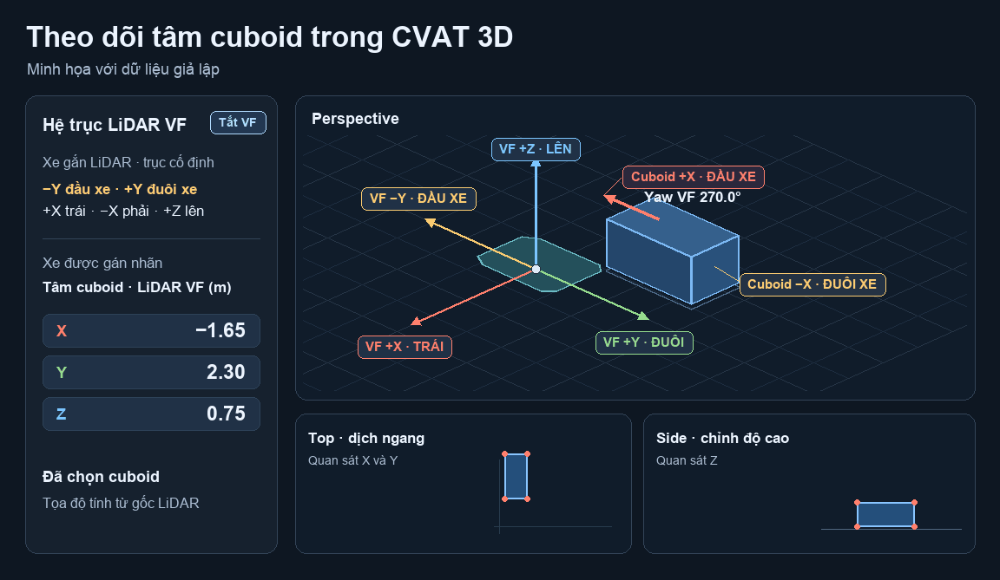

# Lớp chỉ dẫn LiDAR VF cho CVAT 3D

Lớp chỉ dẫn hiển thị hệ trục LiDAR VF, đầu và đuôi cuboid của xe, góc **Yaw VF** và tọa độ tâm **X, Y, Z** cập nhật khi kéo hộp. Thân xe và bảy camera dùng bố trí minh họa.

## Cài vào CVAT local

Cần một hệ thống CVAT Community đang chạy bằng Docker Compose. Image giao diện được build từ mã CVAT UI **2.83.1**. Dùng cùng revision CVAT để khớp giao diện với backend. [Commit CVAT được ghim](https://github.com/cvat-ai/cvat/commit/271806df2ec87462dbb9fcdb76323a83182c8ba0) · [Hướng dẫn cài CVAT Community](https://docs.cvat.ai/docs/administration/community/basics/installation/)

- Trên **Windows x64**, bật WSL 2 và chạy Docker Desktop ở chế độ Linux containers. Có thể chạy lệnh bằng PowerShell hoặc dùng khối Terminal nếu đang quản lý CVAT từ WSL. [Docker Desktop cho Windows](https://docs.docker.com/desktop/setup/install/windows-install/)
- Trên **Mac**, dùng Docker Desktop đúng loại chip. Theo mặc định, Docker chọn `linux/arm64` trên Apple Silicon và `linux/amd64` trên Intel. Yêu cầu kiến trúc của backend tùy bản CVAT đang chạy. [Docker Desktop cho Mac](https://docs.docker.com/desktop/setup/install/mac-install/)

Đặt thư mục `cvat-vf-overlay` bên cạnh thư mục Compose của CVAT. Chạy lệnh **trong thư mục CVAT**, nơi có `docker-compose.yml`. Các lệnh bên dưới dùng image công khai `v2.83.1-vf.2` từ GHCR.

### Windows PowerShell

```powershell
$env:CVAT_VF_IMAGE = 'ghcr.io/thomasminh1995/cvat-vf-overlay:v2.83.1-vf.2'
docker compose -f docker-compose.yml -f ..\cvat-vf-overlay\docker-compose.vf-ego.yml config --quiet
docker compose -f docker-compose.yml -f ..\cvat-vf-overlay\docker-compose.vf-ego.yml pull cvat_ui
docker compose -f docker-compose.yml -f ..\cvat-vf-overlay\docker-compose.vf-ego.yml up -d --no-deps --pull never cvat_ui
```

### macOS Terminal hoặc WSL

```sh
export CVAT_VF_IMAGE=ghcr.io/thomasminh1995/cvat-vf-overlay:v2.83.1-vf.2
docker compose -f docker-compose.yml -f ../cvat-vf-overlay/docker-compose.vf-ego.yml config --quiet
docker compose -f docker-compose.yml -f ../cvat-vf-overlay/docker-compose.vf-ego.yml pull cvat_ui
docker compose -f docker-compose.yml -f ../cvat-vf-overlay/docker-compose.vf-ego.yml up -d --no-deps --pull never cvat_ui
```

Nếu đang dùng file Compose bổ sung hoặc có `-p` riêng, giữ các tham số đó và thêm `-f docker-compose.vf-ego.yml` của overlay cuối danh sách file. File [cho máy cấu hình thấp](docker-compose.lowspec.yml) là tùy chọn khi dựng stack, dùng một tiến trình cho mỗi worker import/export và đưa Grafana vào profile `analytics`.

## Sử dụng trong CVAT 3D

1. Mở một job 3D có dữ liệu theo hệ LiDAR VF. Trong khung **Perspective**, chọn **Bật VF** ở bảng **Hệ trục LiDAR VF**. Mở **Bố trí 7 camera minh họa** nếu cần xem hướng các camera.
2. Chọn một cuboid. Với lớp **Car**, **Truck** hoặc **Bus**, mũi tên đỏ có nhãn **Cuboid +X · ĐẦU XE**. Nhãn **Cuboid −X · ĐUÔI XE** nằm ở phía đối diện. Đọc **Yaw VF** ngay cạnh mũi tên đỏ khi xoay hộp.
3. Giữ chuột trái và kéo bên trong cuboid ở khung **Top** để dịch ngang hoặc kéo lên xuống ở khung **Side** để chỉnh độ cao. Bảng **Tâm cuboid · LiDAR VF (m)** cập nhật X, Y, Z ngay trong lúc kéo. Khi cần ẩn lớp chỉ dẫn, chọn **Tắt VF**. Trình duyệt ghi nhớ lựa chọn theo từng task.



Ảnh động dài 7,5 giây dùng dữ liệu giả lập. [Xem ảnh tĩnh để đối chiếu các nhãn](docs/images/tam-va-huong-cuboid.png).

| Hệ trục | Cách đọc |
| --- | --- |
| **LiDAR VF** | Trục cố định theo xe thu dữ liệu. **−Y** hướng về đầu xe, **+Y** về đuôi xe, **+X** sang trái, **−X** sang phải và **+Z** lên trên. Tọa độ tâm cuboid tính bằng mét từ gốc này. |
| **Cuboid** | Trục gắn với hộp và xoay cùng hộp. **+X** chỉ đầu xe được gán nhãn, **−X** chỉ đuôi xe. |

**Yaw VF** lấy **+X của LiDAR VF** làm 0°. Trong ảnh, cuboid hướng theo **−Y của LiDAR VF** nên yaw bằng **270°**. Nếu cần xem thêm mũi tên trục gốc của CVAT, bật **Appearance → Cuboid orientation**.

### Quay về giao diện gốc

Để quay về giao diện gốc, tạo lại `cvat_ui` bằng các file Compose cũ của dự án.

```sh
docker compose -f docker-compose.yml up -d --no-deps --pull never cvat_ui
```

Nếu image giao diện gốc đã được dọn khỏi máy, chạy `docker compose -f docker-compose.yml pull cvat_ui` trước khi tạo lại service.

## Phát hành lên GitHub

1. Tạo repo GitHub trống và đưa các file của bộ đóng gói vào gốc repo, gồm cả `.github/workflows/publish.yml`. Với repo mới, chạy các lệnh sau trong thư mục đã giải nén và thay URL ví dụ bằng URL của repo.

   ```sh
   git init -b main
   git add .
   git commit -m "Package CVAT VF overlay"
   git remote add origin https://github.com/your-org/cvat-vf-overlay.git
   git push -u origin main
   ```

2. Đẩy tag phiên bản để bắt đầu build.

   ```sh
   git tag v2.83.1-vf.1
   git push origin v2.83.1-vf.1
   ```

3. Workflow **Publish CVAT VF UI** kiểm tra bản vá, build và đẩy một tag image chứa cả `linux/amd64` và `linux/arm64`. Tên image là `ghcr.io/<chủ-sở-hữu>/<repo>:<tag>`, với tên chủ sở hữu và repo ở dạng chữ thường. Workflow dùng quyền `packages: write` của `GITHUB_TOKEN`.
4. Sau lần đẩy đầu tiên, mở package tương ứng trong GitHub **Packages**, vào **Package settings** và đặt **Public** để người dùng có thể tải image công khai. [Hướng dẫn GHCR](https://docs.github.com/en/packages/working-with-a-github-packages-registry/working-with-the-container-registry)

Bản vá, file Compose và hướng dẫn nằm trong repo. Image cài đặt nằm trong GitHub Container Registry.
