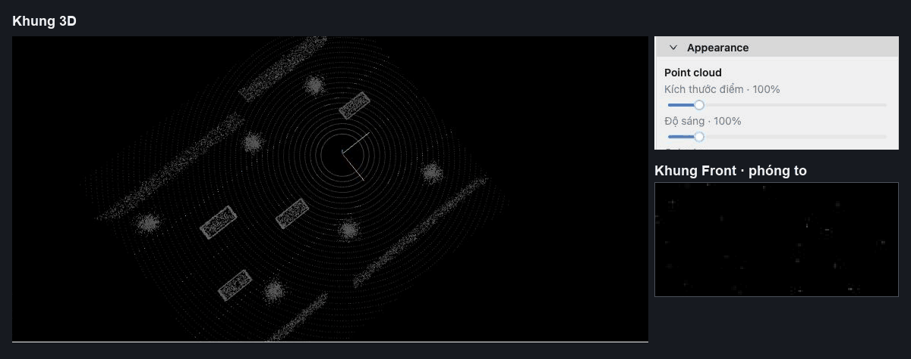

# Lớp chỉ dẫn LiDAR VF cho CVAT 3D

Lớp chỉ dẫn hiển thị hệ trục LiDAR VF, đầu và đuôi cuboid của xe, góc **Yaw VF** và tọa độ tâm **X, Y, Z** cập nhật khi kéo hộp. Thân xe và bảy camera dùng bố trí minh họa.

## Điểm mới trong `vf.4`

- **Điều chỉnh point cloud trong job 3D.** Hai thanh **Kích thước điểm** và **Độ sáng** cập nhật cả bốn góc nhìn. Trình duyệt ghi nhớ mức chỉnh.
- **Tự cập nhật qua kênh `stable`.** Chạy script một lần trên Windows hoặc macOS để lên lịch cập nhật giao diện CVAT.



GIF quay trên CVAT vf.4 bằng dữ liệu giả lập. Khung Front được phóng to để dễ thấy thay đổi kích thước điểm.

## Cài vào CVAT local

Cần một hệ thống CVAT Community đang chạy bằng Docker Compose. Image giao diện được build từ mã CVAT UI **2.83.1**. Dùng cùng revision CVAT để khớp giao diện với backend. [Commit CVAT được ghim](https://github.com/cvat-ai/cvat/commit/271806df2ec87462dbb9fcdb76323a83182c8ba0) · [Hướng dẫn cài CVAT Community](https://docs.cvat.ai/docs/administration/community/basics/installation/)

- Trên **Windows x64**, bật WSL 2 và chạy Docker Desktop ở chế độ Linux containers. Có thể chạy lệnh bằng PowerShell hoặc dùng khối Terminal nếu đang quản lý CVAT từ WSL. [Docker Desktop cho Windows](https://docs.docker.com/desktop/setup/install/windows-install/)
- Trên **Mac**, dùng Docker Desktop đúng loại chip. Theo mặc định, Docker chọn `linux/arm64` trên Apple Silicon và `linux/amd64` trên Intel. Yêu cầu kiến trúc của backend tùy bản CVAT đang chạy. [Docker Desktop cho Mac](https://docs.docker.com/desktop/setup/install/mac-install/)

Đặt thư mục `cvat-vf-overlay` bên cạnh thư mục Compose của CVAT. Chạy lệnh **trong thư mục CVAT**, nơi có `docker-compose.yml`. Các lệnh bên dưới dùng image công khai `v2.83.1-vf.4` từ GHCR.

### Windows PowerShell

```powershell
$env:CVAT_VF_IMAGE = 'ghcr.io/thomasminh1995/cvat-vf-overlay:v2.83.1-vf.4'
docker compose -f docker-compose.yml -f ..\cvat-vf-overlay\docker-compose.vf-ego.yml config --quiet
docker compose -f docker-compose.yml -f ..\cvat-vf-overlay\docker-compose.vf-ego.yml pull cvat_ui
docker compose -f docker-compose.yml -f ..\cvat-vf-overlay\docker-compose.vf-ego.yml up -d --no-deps --pull never cvat_ui
```

### macOS Terminal hoặc WSL

```sh
export CVAT_VF_IMAGE=ghcr.io/thomasminh1995/cvat-vf-overlay:v2.83.1-vf.4
docker compose -f docker-compose.yml -f ../cvat-vf-overlay/docker-compose.vf-ego.yml config --quiet
docker compose -f docker-compose.yml -f ../cvat-vf-overlay/docker-compose.vf-ego.yml pull cvat_ui
docker compose -f docker-compose.yml -f ../cvat-vf-overlay/docker-compose.vf-ego.yml up -d --no-deps --pull never cvat_ui
```

Nếu đang dùng file Compose bổ sung hoặc có `-p` riêng, giữ các tham số đó và thêm `-f docker-compose.vf-ego.yml` của overlay cuối danh sách file. File [cho máy cấu hình thấp](docker-compose.lowspec.yml) là tùy chọn khi dựng stack, dùng một tiến trình cho mỗi worker import/export và đưa Grafana vào profile `analytics`.

### Lớp VF chạy ở đâu

`cvat` là tên mặc định của dự án Docker Compose. Trong nhóm đó, `cvat_ui` phục vụ giao diện web, còn `cvat_server` xử lý API và lưu nhãn. Lớp VF được tích hợp vào image của `cvat_ui` để mã giao diện trong trình duyệt đọc trực tiếp cuboid đang chọn và cập nhật yaw, tọa độ tâm ngay khi kéo. Một dịch vụ riêng vẫn cần phần tích hợp trong giao diện để nhận các thay đổi trên canvas.

Repo này cung cấp bản vá và file Compose bổ sung. File đó trỏ dịch vụ `cvat_ui` đến image đã tích hợp lớp VF. Các dịch vụ CVAT khác tiếp tục dùng cấu hình hiện có.

### Kiểm tra bản cài đã chạy

1. Mở **Docker Desktop → Containers** và mở rộng nhóm dự án CVAT (mặc định là `cvat`). Tìm `cvat_ui` và kiểm tra container đang chạy. Mục **Images → Local** dùng để kiểm tra image đã được tải về.
2. Xác nhận chính container `cvat_ui` đang dùng đúng tag. Chạy lệnh sau trong PowerShell hoặc Terminal.

   ```sh
   docker inspect --type container --format "{{.Config.Image}} {{.State.Status}}" cvat_ui
   ```

   Kết quả mong đợi với bản trong hướng dẫn này.

   ```text
   ghcr.io/thomasminh1995/cvat-vf-overlay:v2.83.1-vf.4 running
   ```

3. Tải lại trang CVAT và mở một job 3D dùng hệ LiDAR VF. Trong khung **Perspective**, tìm bảng **Hệ trục LiDAR VF**. Bấm **Bật VF** để thấy trục và tùy chọn **Hiện 7 camera**. Chọn cuboid để kiểm tra **Yaw VF** và bảng tọa độ tâm như trong ảnh minh họa bên dưới.

## Bật tự cập nhật một lần

Kênh `v2.83.1-vf-stable` dùng cho **backend CVAT 2.83.1**. Giải nén bộ script từ bản phát hành hoặc clone repo. Chạy lệnh trong thư mục bộ script khi **Docker Desktop và CVAT đang chạy**. Script dùng tài khoản hiện tại và lấy thư mục, project và các file Compose từ container `cvat_ui`. Đặt các biến cấu hình riêng của CVAT trong `.env` hoặc file được chọn bằng `--env-file` để lịch chạy có cùng cấu hình.

| Hệ điều hành | Bật tự cập nhật mỗi ngày lúc 08:00 giờ địa phương | Tắt |
| --- | --- | --- |
| Windows PowerShell | `powershell.exe -NoProfile -ExecutionPolicy RemoteSigned -File .\scripts\enable-auto-update.ps1` | Chạy lại lệnh và thêm `-Disable` |
| macOS Terminal | `bash scripts/enable-auto-update.sh` | `bash scripts/enable-auto-update.sh --disable` |

Nếu Windows đánh dấu file tải về, xem nội dung script rồi chạy `Unblock-File -LiteralPath .\scripts\enable-auto-update.ps1` trước khi bật lịch. Script Windows dùng đường dẫn Compose của Windows. Trên macOS dùng tài khoản đăng nhập đang chạy Docker Desktop.

Chọn giờ khác với `-At 07:30` trên Windows hoặc đối số `07:30` trên macOS. Lịch bắt đầu từ lần chạy đã đặt. Nó bỏ qua lần kiểm tra nếu CVAT UI đang dừng hoặc Docker Desktop chưa sẵn sàng. Khi image đổi, Compose thay riêng `cvat_ui`. Chọn giờ trước ca gán nhãn vì giao diện có thể gián đoạn ngắn. Sau khi lưu nhãn, tải lại tab CVAT để dùng bản mới.

Xem nhật ký tại `%LOCALAPPDATA%\CVAT VF Auto Update\update.log` trên Windows hoặc `~/Library/Application Support/CVAT VF Auto Update/update.log` trên macOS. Để quay về một bản cố định, tắt lịch rồi dùng hướng dẫn cài ở trên với tag phiên bản cần dùng.

## Sử dụng trong CVAT 3D

### Chỉnh độ rõ point cloud

Mở **Appearance → Point cloud** trong job 3D. **Kích thước điểm** và **Độ sáng** chạy từ **50% đến 400%** với mặc định **100%**. Bốn góc nhìn cập nhật khi kéo. Trình duyệt ghi nhớ mức chỉnh.

### Bật lớp chỉ dẫn VF

Mở một job 3D có dữ liệu theo hệ LiDAR VF. Trong khung **Perspective**, tìm bảng **Hệ trục LiDAR VF** và bấm **Bật VF**. Khi lớp chỉ dẫn hiện lên, nút chuyển thành **Tắt VF** như trong ảnh bên dưới.

Trong card, bỏ chọn **Hiện 7 camera** để ẩn các ký hiệu camera và dễ quan sát trục, cuboid. Chọn lại để xem camera trong khung 3D và mở **Bố trí 7 camera minh họa**. Trình duyệt ghi nhớ lựa chọn theo từng task.

### Chọn cuboid và đọc hướng xe

Chọn cuboid của xe trong khung **Perspective**. Quan sát gốc trục trên xe gắn LiDAR và mũi tên đỏ trên cuboid.

| Hệ trục | Vị trí và hướng |
| --- | --- |
| **LiDAR VF** | Cố định tại gốc LiDAR của xe thu dữ liệu. **−Y** là đầu xe, **+Y** là đuôi, **+X** sang trái, **−X** sang phải và **+Z** lên trên. |
| **Cuboid** | Xoay cùng hộp. Với lớp **Car**, **Truck** hoặc **Bus**, mũi tên đỏ **Cuboid +X · ĐẦU XE** chỉ đầu xe được gán nhãn. **Cuboid −X · ĐUÔI XE** nằm ở phía đối diện. |


Đọc **Yaw VF** cạnh mũi tên đỏ. Góc lấy **+X của LiDAR VF** làm 0°. Trong ảnh minh họa, mũi tên đầu cuboid chỉ theo **−Y của LiDAR VF**, tương ứng **270°**. Để đổi hướng, kéo điểm xoay của cuboid trong khung **Top** và đọc lại góc.

Để hiện mũi tên định hướng gốc của CVAT, bật **Appearance → Cuboid orientation**.

### Kéo cuboid và theo dõi tọa độ tâm

1. Trong khung **Top**, giữ chuột trái bên trong cuboid và kéo để dịch ngang. Quan sát **X** và **Y** trong bảng **Tâm cuboid · LiDAR VF (m)**.
2. Trong khung **Side**, kéo cuboid theo chiều dọc để chỉnh độ cao. Quan sát **Z** trong cùng bảng.
3. Đọc các giá trị ngay khi đang giữ chuột. Chúng là tọa độ tâm tính bằng mét từ gốc LiDAR VF.


Ảnh tĩnh và GIF 7,5 giây dùng dữ liệu giả lập. Để ẩn lớp chỉ dẫn, bấm **Tắt VF**. Trình duyệt ghi nhớ lựa chọn theo từng task.

### Quay về giao diện gốc

Để quay về giao diện gốc, tạo lại `cvat_ui` bằng các file Compose cũ của dự án.

```sh
docker compose -f docker-compose.yml up -d --no-deps --pull never cvat_ui
```

Nếu image giao diện gốc đã được dọn khỏi máy, chạy `docker compose -f docker-compose.yml pull cvat_ui` trước khi tạo lại service.

## Phát hành lên kênh stable

Push tag phiên bản `v2.83.1-vf.<số>` để workflow **Publish CVAT VF UI** build image cho AMD64 và ARM64. Sau khi xác nhận bản đó, đặt Git tag `v2.83.1-vf-stable` trên cùng commit và push. Workflow hiện tại sẽ build và cập nhật image cùng tên trên GHCR.

Ở lần phát hành tiếp theo, lưu SHA đang trỏ trên remote trước khi chuyển Git tag stable sang bản mới. Ví dụ trên macOS, WSL hoặc Git Bash, thay `<tag-da-kiem-tra>` bằng tag phiên bản cần phát hành.

```sh
channel=v2.83.1-vf-stable
old=$(git ls-remote origin "refs/tags/$channel" | cut -f1)
git tag -f "$channel" <tag-da-kiem-tra>
git push --force-with-lease="refs/tags/$channel:$old" origin "refs/tags/$channel"
```

Xác nhận workflow của tag stable đã chạy thành công trước khi thông báo. Máy đã đăng ký lịch sẽ tải bản mới trong lần kiểm tra tiếp theo.
