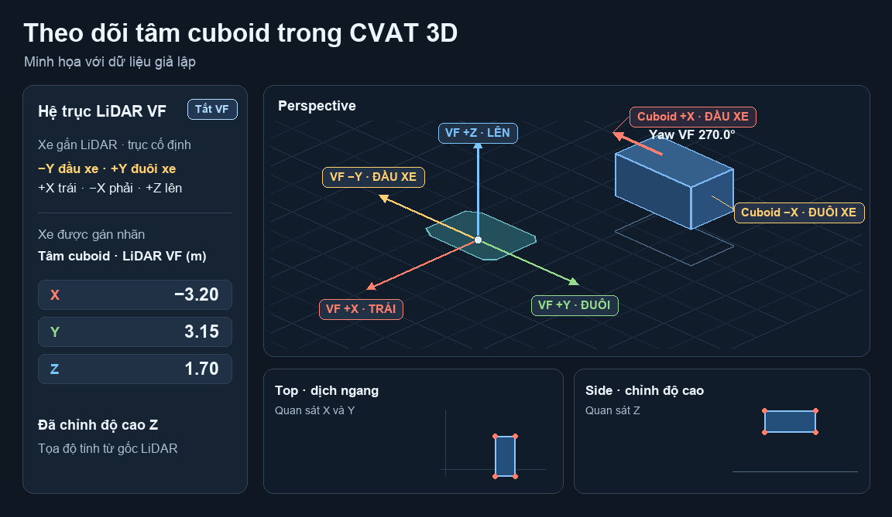

# Lớp chỉ dẫn LiDAR VF cho CVAT 3D

Lớp chỉ dẫn hiển thị hệ trục LiDAR VF, đầu và đuôi cuboid của xe, góc **Yaw VF** và tọa độ tâm **X, Y, Z** cập nhật khi kéo hộp. Thân xe và bảy camera dùng bố trí minh họa.

## Cài vào CVAT local

Cần một hệ thống CVAT Community đang chạy bằng Docker Compose. Image giao diện được build từ mã CVAT UI **2.83.1**. Dùng cùng revision CVAT để khớp giao diện với backend. [Commit CVAT được ghim](https://github.com/cvat-ai/cvat/commit/271806df2ec87462dbb9fcdb76323a83182c8ba0) · [Hướng dẫn cài CVAT Community](https://docs.cvat.ai/docs/administration/community/basics/installation/)

- Trên **Windows x64**, bật WSL 2 và chạy Docker Desktop ở chế độ Linux containers. Có thể chạy lệnh bằng PowerShell hoặc dùng khối Terminal nếu đang quản lý CVAT từ WSL. [Docker Desktop cho Windows](https://docs.docker.com/desktop/setup/install/windows-install/)
- Trên **Mac**, dùng Docker Desktop đúng loại chip. Theo mặc định, Docker chọn `linux/arm64` trên Apple Silicon và `linux/amd64` trên Intel. Yêu cầu kiến trúc của backend tùy bản CVAT đang chạy. [Docker Desktop cho Mac](https://docs.docker.com/desktop/setup/install/mac-install/)

Đặt thư mục `cvat-vf-overlay` bên cạnh thư mục Compose của CVAT. Chạy lệnh **trong thư mục CVAT**, nơi có `docker-compose.yml`. Các lệnh bên dưới dùng image công khai `v2.83.1-vf.3` từ GHCR.

### Windows PowerShell

```powershell
$env:CVAT_VF_IMAGE = 'ghcr.io/thomasminh1995/cvat-vf-overlay:v2.83.1-vf.3'
docker compose -f docker-compose.yml -f ..\cvat-vf-overlay\docker-compose.vf-ego.yml config --quiet
docker compose -f docker-compose.yml -f ..\cvat-vf-overlay\docker-compose.vf-ego.yml pull cvat_ui
docker compose -f docker-compose.yml -f ..\cvat-vf-overlay\docker-compose.vf-ego.yml up -d --no-deps --pull never cvat_ui
```

### macOS Terminal hoặc WSL

```sh
export CVAT_VF_IMAGE=ghcr.io/thomasminh1995/cvat-vf-overlay:v2.83.1-vf.3
docker compose -f docker-compose.yml -f ../cvat-vf-overlay/docker-compose.vf-ego.yml config --quiet
docker compose -f docker-compose.yml -f ../cvat-vf-overlay/docker-compose.vf-ego.yml pull cvat_ui
docker compose -f docker-compose.yml -f ../cvat-vf-overlay/docker-compose.vf-ego.yml up -d --no-deps --pull never cvat_ui
```

Nếu đang dùng file Compose bổ sung hoặc có `-p` riêng, giữ các tham số đó và thêm `-f docker-compose.vf-ego.yml` của overlay cuối danh sách file. File [cho máy cấu hình thấp](docker-compose.lowspec.yml) là tùy chọn khi dựng stack, dùng một tiến trình cho mỗi worker import/export và đưa Grafana vào profile `analytics`.

## Sử dụng trong CVAT 3D

### Bật lớp chỉ dẫn VF

Mở một job 3D có dữ liệu theo hệ LiDAR VF. Trong khung **Perspective**, tìm bảng **Hệ trục LiDAR VF** và bấm **Bật VF**. Khi lớp chỉ dẫn hiện lên, nút chuyển thành **Tắt VF** như trong ảnh bên dưới.

Trong card, bỏ chọn **Hiện 7 camera** để ẩn các ký hiệu camera và dễ quan sát trục, cuboid. Chọn lại để xem camera trong khung 3D và mở **Bố trí 7 camera minh họa**. Trình duyệt ghi nhớ lựa chọn theo từng task.

### Chọn cuboid và đọc hướng xe

Chọn cuboid của xe trong khung **Perspective**. Quan sát gốc trục trên xe gắn LiDAR và mũi tên đỏ trên cuboid.

| Hệ trục | Vị trí và hướng |
| --- | --- |
| **LiDAR VF** | Cố định tại gốc LiDAR của xe thu dữ liệu. **−Y** là đầu xe, **+Y** là đuôi, **+X** sang trái, **−X** sang phải và **+Z** lên trên. |
| **Cuboid** | Xoay cùng hộp. Với lớp **Car**, **Truck** hoặc **Bus**, mũi tên đỏ **Cuboid +X · ĐẦU XE** chỉ đầu xe được gán nhãn. **Cuboid −X · ĐUÔI XE** nằm ở phía đối diện. |



Đọc **Yaw VF** cạnh mũi tên đỏ. Góc lấy **+X của LiDAR VF** làm 0°. Trong ảnh minh họa, mũi tên đầu cuboid chỉ theo **−Y của LiDAR VF**, tương ứng **270°**. Để đổi hướng, kéo điểm xoay của cuboid trong khung **Top** và đọc lại góc.

Để hiện mũi tên định hướng gốc của CVAT, bật **Appearance → Cuboid orientation**.

### Kéo cuboid và theo dõi tọa độ tâm

1. Trong khung **Top**, giữ chuột trái bên trong cuboid và kéo để dịch ngang. Quan sát **X** và **Y** trong bảng **Tâm cuboid · LiDAR VF (m)**.
2. Trong khung **Side**, kéo cuboid theo chiều dọc để chỉnh độ cao. Quan sát **Z** trong cùng bảng.
3. Đọc các giá trị ngay khi đang giữ chuột. Chúng là tọa độ tâm tính bằng mét từ gốc LiDAR VF.


Ảnh tĩnh và GIF 7,5 giây dùng dữ liệu giả lập. Để ẩn lớp chỉ dẫn, bấm **Tắt VF**. Trình duyệt ghi nhớ lựa chọn theo từng task.

### Quay về giao diện gốc

Để quay về giao diện gốc, tạo lại `cvat_ui` bằng các file Compose cũ của dự án.

```sh
docker compose -f docker-compose.yml up -d --no-deps --pull never cvat_ui
```

Nếu image giao diện gốc đã được dọn khỏi máy, chạy `docker compose -f docker-compose.yml pull cvat_ui` trước khi tạo lại service.
